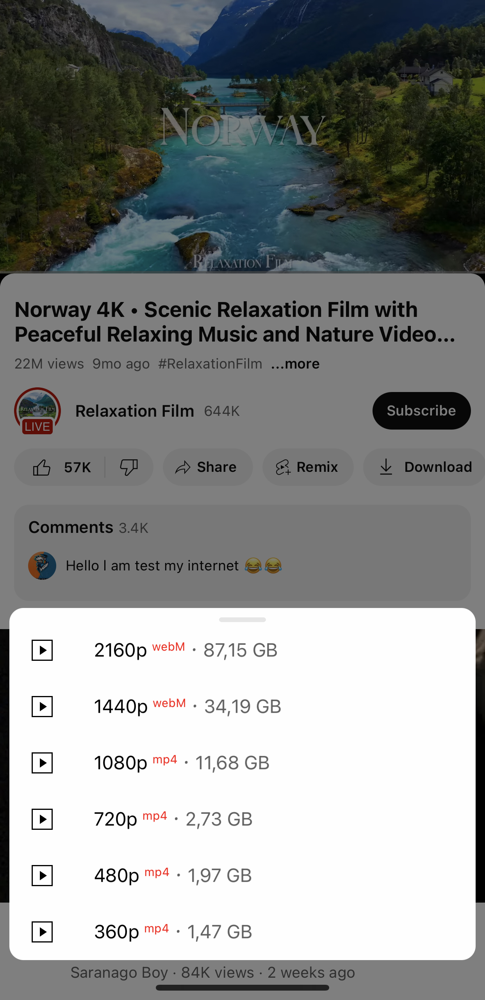
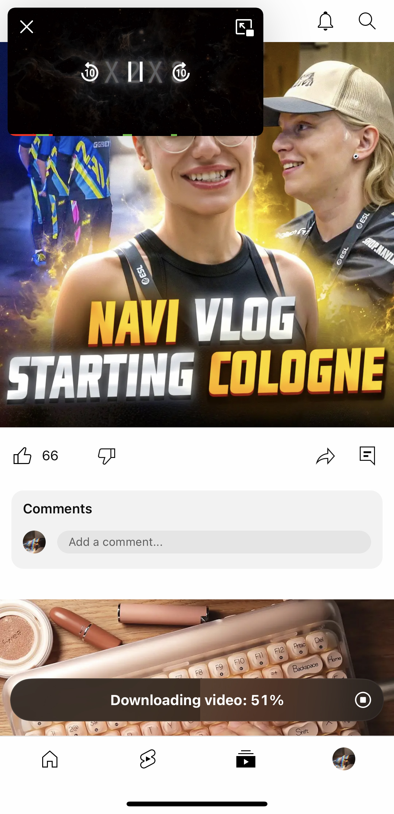
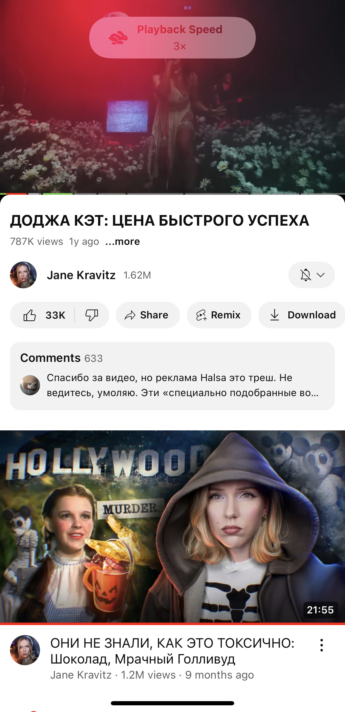
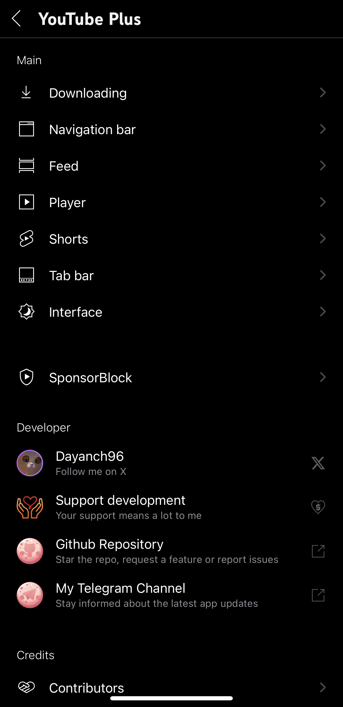
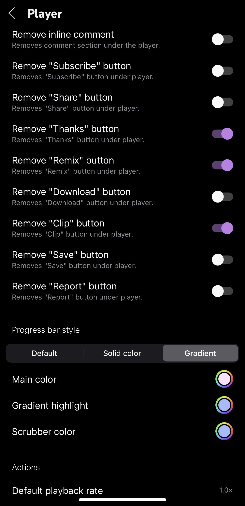
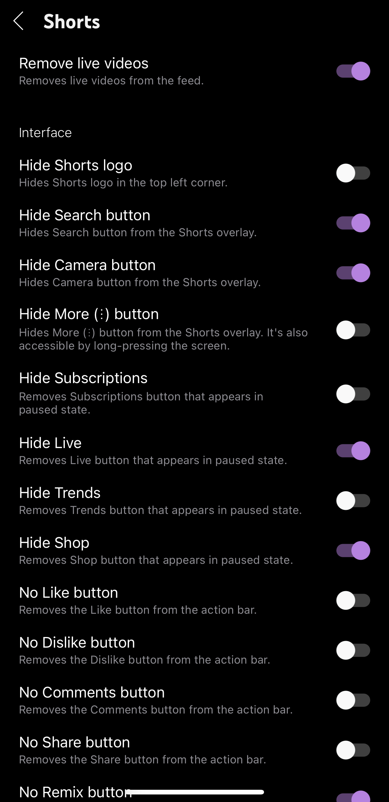
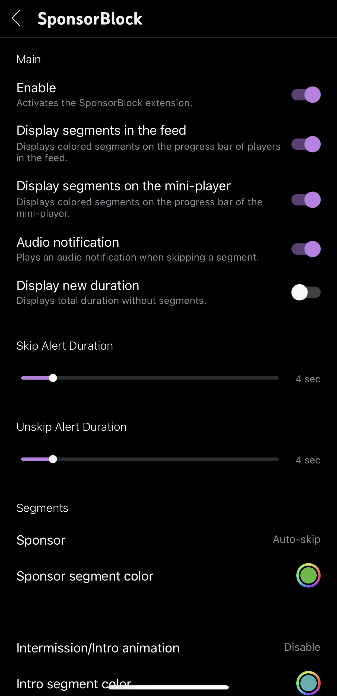
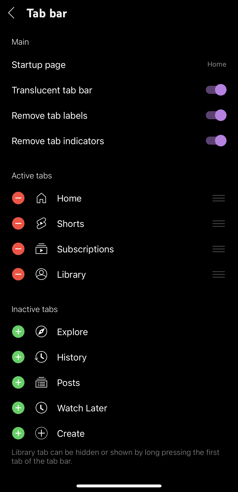
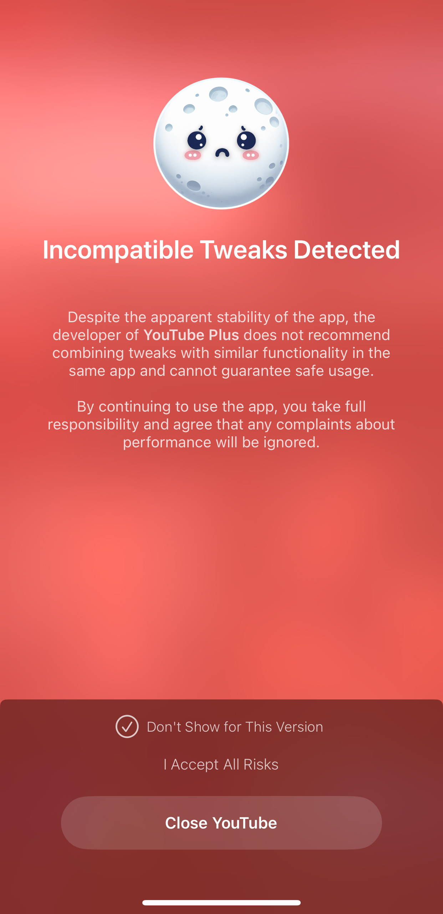

  # DTLite Plus

  

    <b>The definitive, modular, and performance-driven enhancement suite for YouTube on iOS.</b> 
    <i>Includes background playback, media downloads, SponsorBlock, resolution unlocks, and deep UI personalization.</i>
  

  

    
    
    
    
  

  

    <a href="#-features-at-a-glance">Features</a> •
    <a href="#-screenshots">Screenshots</a> •
    <a href="#-quick-start--cloud-builds">Cloud Build Guide</a> •
    <a href="#-bundled-tweak-modules">Tweak Modules</a> •
    <a href="#-compatibility--installation">Compatibility</a> •
    <a href="#-frequently-asked-questions">FAQ</a>
  

---

## 📌 Project Overview

| Property | Details |
|---|---|
| **Project Name** | **DTLite Plus** |
| **Installed Home Screen Name** | **DexTube** *(Default display name on iOS)* |
| **Release Artifact** | **`DTLitePlus_v<TweakVer>_<YTVer>.ipa`** |
| **Build Engine** | Fully automated GitHub Actions cloud builder |
| **Primary Base** | Dayanch96's YTLite with multi-tweak injection suite |

---

## ✨ Features at a Glance

<table>
  <tr>
    <td width="50%" valign="top">
      <h3>📥 All-in-One Media Downloader</h3>
      <ul>
        <li><b>High-Definition Video:</b> Save videos up to <b>4K (2160p 60fps)</b> directly to the Camera Roll or Files app.</li>
        <li><b>Audio Track Extractor:</b> Download standalone audio with multi-language audio track selection.</li>
        <li><b>Shorts & Stories:</b> Seamlessly download YouTube Shorts with zero watermarks.</li>
        <li><b>Media Assets:</b> Save high-res thumbnails, community post pictures, and channel avatars.</li>
        <li><b>One-Tap Clipboard:</b> Fast copy for video links, descriptions, captions, and comments.</li>
      </ul>
    </td>
    <td width="50%" valign="top">
      <h3>🛡️ Ad & Clutter Elimination</h3>
      <ul>
        <li><b>Built-in SponsorBlock:</b> Automatically skips sponsors, intros, subscription reminders, and non-music sections.</li>
        <li><b>Ad-Free Experience:</b> Cleans video feed ads, promoted banners, and interstitial popups.</li>
        <li><b>Home Feed Filtering:</b> Hide the Shorts shelf, community posts, breaking news, and trending reels.</li>
        <li><b>Overlay Cleaner:</b> Disables channel watermarks, related videos end-screens, and suggested card clutter.</li>
      </ul>
    </td>
  </tr>
  <tr>
    <td width="50%" valign="top">
      <h3>📺 Playback & Video Quality</h3>
      <ul>
        <li><b>Native Picture-in-Picture:</b> Picture-in-Picture (PiP) enabled for standard videos, live streams, and Shorts.</li>
        <li><b>Background Playback:</b> Continue listening with the screen turned off or while switching apps.</li>
        <li><b>Resolution Unlocks (YTUHD):</b> Unlocks VP9 codec to stream 1440p (2K) and 2160p (4K) on all devices.</li>
        <li><b>Granular Quality Picker:</b> Bypasses Apple's simplified quality menus to choose exact resolutions.</li>
        <li><b>Volume Booster:</b> Increase audio levels past standard system boundaries with VolumeBoostYT.</li>
      </ul>
    </td>
    <td width="50%" valign="top">
      <h3>🎨 Customization & Controls</h3>
      <ul>
        <li><b>True OLED Theme:</b> Pitch-black dark mode tailored for Super Retina OLED screens.</li>
        <li><b>Dislike Counters (RYD):</b> Restores public dislike counts and ratios via the official RYD API.</li>
        <li><b>Dynamic Island Fix:</b> Notch & island avoidance for 2:1 widescreen videos via DontEatMyContent.</li>
        <li><b>Interface Layout:</b> Reorder, hide, or set a custom startup tab.</li>
        <li><b>A/B Flags & Miniplayer:</b> Modify hidden internal flags via YTABConfig and customize miniplayer styles.</li>
      </ul>
    </td>
  </tr>
</table>

> [!TIP]
> All DTLite Plus settings and options are seamlessly embedded into the native **YouTube Settings** menu inside the app.

---

## 📸 Screenshots

  <table>
    <tr>
      <td align="center"></td>
      <td align="center"></td>
      <td align="center"></td>
    </tr>
  </table>

  

    
<b>🔍 Tap to View More Screenshots (Screenshots 4 – 9)</b>

     
    <table>
      <tr>
        <td align="center"></td>
        <td align="center"></td>
        <td align="center"></td>
      </tr>
      <tr>
        <td align="center"></td>
        <td align="center"></td>
        <td align="center"></td>
      </tr>
    </table>
  

---

## 🚀 Quick Start / Cloud Builds

Build your own customized `.ipa` directly on GitHub servers in less than 5 minutes — completely free, with no macOS machine or Xcode installation needed.

### ⚙️ Step 1: Prepare Your Fork
1. Click the **Fork** button at the top-right corner of this repository.
2. In your new fork, open **Settings** > **Actions** > **General**.
3. Under **Workflow permissions**, select **Read and write permissions** and click **Save**.

### 🔑 Step 2: (Recommended) Add Secret Tweak URL
You **no longer need to paste your tweak URL on every build**! You can save it once:
1. Go to **Settings** > **Secrets and variables** > **Actions** > **New repository secret**.
2. Set **Name:** `TWEAK_URL`
3. Set **Value:** `<Direct download URL to your DTLite/YTLite .deb file>`
4. Click **Add secret**. Now you can leave the `tweak_url` field completely blank whenever you trigger a build!

---

### 📦 Build Workflow 1: By URL (Recommended)

Ideal for building with your custom/beta `.deb` link or automatic `secret.TWEAK_URL`.

  
<b>Click for workflow steps</b>

1. Head to the **Actions** tab in your repository.
2. In the left sidebar, choose **Create DTLite Plus App By URL**.
3. Click the **Run workflow** button on the right.
4. Fill in the parameters:
   - **`ipa_url`**: Direct download link to your decrypted YouTube IPA *(e.g. uploaded to Dropbox, Google Drive, Filemail, etc.)*.
   - **`tweak_url`**: Leave **blank** to use your saved `secret.TWEAK_URL` *(or paste a specific URL to override)*.
   - **`display_name`**: Defaults to **`DexTube`** *(name shown under the icon on iOS)*.
   - **`bundle_id`**: Defaults to `com.google.ios.youtube` *(or change for duplicate installation)*.
   - **Tweaks checkboxes**: Toggle any integrations you want included.
5. Click **Run workflow**.
6. When complete, download your signed/unsigned IPA package directly from your repository's **Releases** page!

---

### 🏷️ Build Workflow 2: By Release Version

Pulls a specific official release version directly from upstream archives.

  
<b>Click for workflow steps</b>

1. Go to the **Actions** tab > select **Create DTLite Plus App By Version**.
2. Click **Run workflow**.
3. Enter your decrypted YouTube IPA link and the desired tweak version (e.g. `6.0`).
4. Select your preferred tweaks and click **Run workflow**.
5. Collect your ready `.ipa` file under **Releases** once built.

---

## 🧩 Bundled Tweak Modules

DTLite Plus integrates the finest tweaks from the iOS jailbreak and sideloading community:

| Module | Description | Default | Author / Repository |
|---|---|:---:|---|
| **YouPiP** | Enables native iOS Picture-in-Picture playback for all videos. | ✅ | [PoomSmart/YouPiP](https://github.com/PoomSmart/YouPiP) |
| **YTUHD** | Unlocks VP9 codec to support 1440p (2K) & 2160p (4K) streams. | ✅ | [PoomSmart/YTUHD](https://github.com/PoomSmart/YTUHD) |
| **Return YouTube Dislikes** | Fetches live dislike counts and ratio bars via the RYD API. | ✅ | [PoomSmart/Return-YouTube-Dislikes](https://github.com/PoomSmart/Return-YouTube-Dislikes) |
| **YouQuality** | Quick video resolution switcher in the active video overlay. | ✅ | [PoomSmart/YouQuality](https://github.com/PoomSmart/YouQuality) |
| **YouChooseQuality** | Removes simplified labels and restores standard resolution options. | ✅ | [PoomSmart/YouChooseQuality](https://github.com/PoomSmart/YouChooseQuality) |
| **DontEatMyContent** | Prevents the camera notch and Dynamic Island from clipping 2:1 videos. | ✅ | [therealFoxster/DontEatMyContent](https://github.com/therealFoxster/DontEatMyContent) |
| **VolumeBoostYT** | Boosts player volume output beyond standard iOS audio limitations. | ✅ | [VasirakCalgux/VolumeBoostYT](https://github.com/VasirakCalgux/VolumeBoostYT) |
| **YTAnotherMiniplayer** | Restores legacy and alternative floating miniplayer interfaces. | ✅ | [PoomSmart/YTAnotherMiniplayer](https://github.com/PoomSmart/YTAnotherMiniplayer) |
| **YTABConfig** | Enables inspection and live toggling of internal YouTube A/B feature experiments. | ✅ | [PoomSmart/YTABConfig](https://github.com/PoomSmart/YTABConfig) |
| **Localization** | Automatically syncs and updates community translations from this repo. | ✅ | Community Translators |

---

## 📱 Compatibility & Installation

### Supported iOS & App Versions
* **Latest Confirmed YouTube Version:** `v21.44.4`
* **Tested Tweak Version:** `v5.2.2` / `v6.0`

### Sideloading Matrix
| iOS Version | Recommended YouTube Target | Supported Sideloaders |
|---|---|---|
| **iOS 16.0 – 18.x** | Latest supported YouTube version | **TrollStore** (best), **SideStore**, **AltStore**, **Feather**, **Scarlet**, **LiveContainer** |
| **iOS 15.0 – 15.8** | YouTube `v20.21.6` | **TrollStore** (permanent), SideStore, AltStore |
| **iOS 14.0 – 14.8** | YouTube `v19.20.2` | **TrollStore**, AltStore, Jailbreak tweaks |

---

## ❓ Frequently Asked Questions

Read our detailed troubleshooting and installation instructions in your preferred language:

* 🇺🇸 [English FAQ](FAQs/FAQ_EN.md)
* 🇷🇺 [ЧаВо на Русском](FAQs/FAQ_RU.md)
* 🇮🇹 [FAQ in Italiano](FAQs/FAQ_IT.md)
* 🇵🇱 [FAQ po Polsku](FAQs/FAQ_PL.md)

---

## 👏 Credits & Acknowledgments

Sincere gratitude to all developers whose open-source tools and libraries make this possible:

* **[dayanch96](https://github.com/dayanch96)** — Creator of the core [YTLite](https://github.com/dayanch96/YTLite) tweak
* **[PoomSmart](https://github.com/PoomSmart)** — YouPiP, YTUHD, Return-YouTube-Dislikes, YouQuality, YouChooseQuality, YTABConfig, YTAnotherMiniplayer, YouTubeHeader
* **[therealFoxster](https://github.com/therealFoxster)** — DontEatMyContent
* **[VasirakCalgux](https://github.com/VasirakCalgux)** — VolumeBoostYT
* **[asdfzxcvbn](https://github.com/asdfzxcvbn)** — pyzule-rw (cyan) injection engine
* **[Theos Team](https://github.com/theos/theos)** — Theos build environment & SDKs
* **[@qbap](https://github.com/qbap)** — Independent review and coverage on [ONE Jailbreak](https://onejailbreak.com/blog/youtube-plus/)

---

  DTLite Plus is an independent open-source project. Not affiliated with, sponsored by, or endorsed by Google LLC or YouTube.

